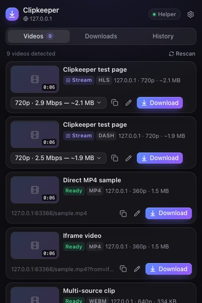
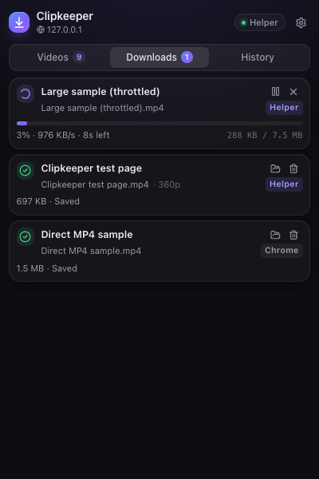
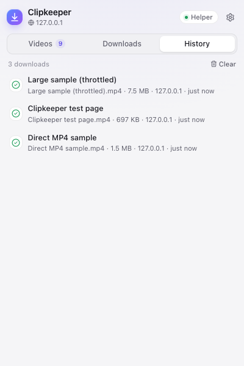

# Clipkeeper — Chrome Video Downloader

Clipkeeper is a Manifest V3 Chrome extension that finds the videos on the current tab and saves the ones you own or are allowed to keep. An optional local helper (Node.js) adds HLS/DASH stream downloads (merged with FFmpeg), saving to any folder, and opt-in yt-dlp support.

It **never bypasses DRM, encryption, sign-ins or paywalls**, and it **never sends your browsing data anywhere**.

> [!IMPORTANT]
> **Legal notice.** Only download videos you own, that are licensed for copying, or that you have permission to download, and follow each website's terms of service. You are solely responsible for how you use this software. It is provided "as is" without warranty under the [MIT License](LICENSE); the authors accept no liability for misuse. Clipkeeper is not affiliated with any website or rights holder. Read the full [DISCLAIMER](DISCLAIMER.md) before use.

<p>
  
  
  
</p>

---

## Features

**Detection**
- `<video>` and `<source>` elements (several sources become a quality selector), including inside open shadow DOM
- Videos added after the page loads (MutationObserver plus media events) and videos inside accessible iframes
- Links to video files and `og:video` metadata
- HLS (`.m3u8`) and DASH (`.mpd`) manifests the player requests, picked up from network traffic and inspected for variants, duration, encryption and live status
- Media Source (blob:) players are detected and clearly explained; DRM players (EME) are flagged as **Protected**
- Each video shows title, site, format, resolution, size (exact or estimated), duration and availability

**Downloads**
- Direct MP4/WebM/MOV/… files through Chrome's own downloader (no helper needed) or through the helper
- HLS and DASH downloads through the helper: picks the variant and audio track, downloads segments in parallel, then remuxes them with FFmpeg (no re-encoding)
- Resolution selector (360p … 4K), with the highest quality chosen automatically by default
- Live percentage, speed and remaining time, with pause, resume, cancel and retry
- Automatic retries with backoff; direct files resume with HTTP Range requests
- Duplicate prevention (something already downloading, or already downloaded with "Download again"), custom file names and templates, folder selection (native picker), history, and completion notifications

**Interface**
- Dark and light themes (or follow the system)
- Popup tabs for Videos, Downloads and History, plus a full settings page

---

## Requirements

| | Needed for | macOS | Windows |
|---|---|---|---|
| **Google Chrome** 120+ (or Edge/Brave) | everything | — | — |
| **Node.js** 20.10+ (22 LTS recommended) | building the extension, running the helper | `brew install node` | `winget install OpenJS.NodeJS.LTS` |
| **FFmpeg** | merging HLS/DASH streams | `brew install ffmpeg` | `winget install --id Gyan.FFmpeg -e` |
| **yt-dlp** *(optional)* | supported sites, opt-in | `brew install yt-dlp` | `winget install --id yt-dlp.yt-dlp -e` |

Direct video files download through Chrome with no helper at all. FFmpeg is needed only for streams. Without it, single-track HLS streams are saved as `.ts`, and streams with separate audio and video tracks can't be merged.

<details>
<summary>macOS: installing Homebrew first</summary>

```bash
/bin/bash -c "$(curl -fsSL https://raw.githubusercontent.com/Homebrew/install/HEAD/install.sh)"
```
Then run the `brew install` commands from the table, and check them with `node -v && ffmpeg -version`.
</details>

<details>
<summary>Windows: notes</summary>

- Run the `winget` commands in PowerShell, then **open a new terminal** so `PATH` is refreshed.
- If FFmpeg was unzipped manually, either add its `bin` folder to `PATH` or set `CLIPKEEPER_FFMPEG=C:\path\to\ffmpeg.exe` (and `CLIPKEEPER_FFPROBE`, `CLIPKEEPER_YTDLP` likewise).
- Chocolatey (`choco install ffmpeg yt-dlp`) and Scoop (`scoop install ffmpeg yt-dlp`) are detected too.
</details>

---

## Installation

### 1. Install dependencies and build the extension

```bash
cd clipkeeper
npm install
npm run build
```

The unpacked extension is written to `extension/dist/`.

### 2. Load it in Chrome

1. Open **`chrome://extensions`**.
2. Turn on **Developer mode** (top-right toggle).
3. Click **Load unpacked** and select the **`extension/dist`** folder.
4. Pin Clipkeeper from the puzzle-piece menu so its icon stays on the toolbar.
5. Clipkeeper opens its settings page on first install.

After pulling changes, run `npm run build` again and click the ↻ reload button on the Clipkeeper card in `chrome://extensions`.

### 3. Start the local helper (for streams)

```bash
npm run start:backend
```

On startup it prints its address (`http://127.0.0.1:47321`), the **pairing token**, the download folder, and whether FFmpeg and yt-dlp were found. Leave this terminal open while you download streams. To check your setup without starting the helper:

```bash
npm run doctor
```

### 4. Pair the extension with the helper

1. Open Clipkeeper **Settings** (gear icon in the popup, or right-click the toolbar icon → *Options*).
2. Under **Local helper**, paste the token and click **Save & connect**.
3. The status turns green and shows the FFmpeg and yt-dlp versions. The popup's status pill now reads **Helper**.

Print the token again any time with `npm run token`. Create a new one (and re-pair) with `npm run rotate-token --workspace @clipkeeper/backend`.

---

## Usage

1. Open a page with a video. For streaming sites, **start playback**: players only load their manifests when you press play.
2. Click the Clipkeeper icon. The badge shows how many videos were found.
3. For each video you can:
   - choose a quality (when several are available),
   - click ✎ to set a custom file name,
   - copy the media URL,
   - click **Download**.
4. Follow progress in **Downloads**: pause, resume, cancel, retry, or show the file in its folder.
5. **History** keeps finished downloads (stored only on your computer).

### What the badges mean

| Badge | Meaning |
|---|---|
| **Ready** | A direct file; downloads through Chrome right away |
| **Stream** | HLS/DASH; saved by the helper |
| **Needs helper** | A stream, but the helper isn't connected |
| **Protected** | DRM or encryption detected; Clipkeeper will not download it |
| **Not directly saveable** | A Media Source (blob:) player; use the stream entry listed separately if the page loaded one |
| **Live** | A live stream; recording isn't supported |

### Settings overview

| Setting | Where it applies |
|---|---|
| Default quality, preferred format, file-name template (`{title} {site} {resolution} {date}`) | Extension |
| Engine for direct files (Chrome or helper), Chrome sub-folder, "Ask where to save" | Extension |
| Helper download folder (typed, or picked with the native **Choose…** dialog), simultaneous downloads | Helper |
| Allowed/blocked download domains, allow local-network sources, yt-dlp opt-in and its domain list | Helper |
| Theme, notifications, toolbar badge | Extension |

Helper data lives in `~/Library/Application Support/Clipkeeper` (macOS), `%APPDATA%\Clipkeeper` (Windows) or `~/.config/clipkeeper` (Linux). Set `CLIPKEEPER_HOME` to use a different folder. The default download folder is `~/Downloads/Clipkeeper Videos` (kept distinct from a `clipkeeper` checkout, since macOS and Windows file names are case-insensitive).

### Command-line options

```bash
npm run start:backend -- --port 47400 --download-dir "/Volumes/Media/Clips" --verbose
```
If you change the port, update the helper URL in the extension settings to match.

---

## Security and compliance

- **No DRM or encryption bypass.** EME-protected players, HLS playlists with any `#EXT-X-KEY` method other than `NONE`, and DASH manifests with `ContentProtection` are refused. Live streams are refused.
- **No authentication bypass.** The helper never receives or uses browser cookies or accounts; it can only fetch what is publicly reachable. Chrome-engine downloads behave exactly like "Save video as…".
- **Locked-down helper:**
  - it binds to `127.0.0.1` only;
  - every API call except `/api/health` needs the 256-bit token, which is compared in constant time;
  - `Host` headers are checked (DNS-rebinding defence), and non-extension `Origin` values are rejected;
  - repeated failed logins are rate-limited;
  - request bodies are validated with strict zod schemas and capped at 64 KB.
- **SSRF protection:**
  - only `http(s)` URLs, with no embedded credentials;
  - the DNS lookup used for each connection rejects loopback, private, link-local (including cloud metadata), CGNAT, multicast and reserved IPv4/IPv6 ranges, including IPv4-mapped, NAT64 and 6to4 forms;
  - every redirect and every segment URL is checked again;
  - FFmpeg is limited to local files (`-protocol_whitelist file,pipe`).
- **Filesystem safety:** the download folder must be an absolute, writable, non-system path; file names are sanitized (path separators, reserved Windows names, control and bidi characters, length); every final path is verified to stay inside the download folder.
- **No arbitrary command execution:** the helper only ever starts FFmpeg, yt-dlp, the native folder picker and Finder/Explorer "reveal", each with a fixed argument list and no shell. yt-dlp runs with `--ignore-config --no-exec --no-cookies` and `--` before the URL.
- **Privacy:** no analytics, no remote servers. Detections live in session storage and are cleared on navigation. History stays on your computer.

Only download content you own or have explicit permission to download, and respect each site's terms of service. More detail is in [docs/SECURITY.md](docs/SECURITY.md).

---

## Development

```bash
npm run build          # build the extension → extension/dist
npm run start:backend  # run the helper
npm run dev:backend    # helper with auto-restart on changes
npm run typecheck      # TypeScript across all packages
npm test               # unit + integration tests (Vitest)
npm run test:unit      # shared, backend and extension unit tests
npm run test:integration
npm run test:e2e       # builds, then drives the real extension in Chromium (Playwright)
npm run fixtures       # (re)generate the FFmpeg sample media used by tests
```

The end-to-end test needs Playwright's Chromium once: `npx playwright install chromium`. Branded Chrome 137+ can't load unpacked extensions from the command line. Run it with `HEADED=1 npm run test:e2e` to watch. Screenshots are saved to `tests/e2e/.artifacts/`.

### Project structure

```
clipkeeper/
├── shared/      Types, API contract (zod), HLS/DASH parsers, URL + filename utilities, quality picker
├── backend/     Fastify helper: auth hooks, SSRF-guarded HTTP client, job queue,
│                direct/HLS/DASH/yt-dlp runners, FFmpeg remux, dependency detection, CLI
├── extension/   MV3 extension: content script (detection), service worker (sniffer,
│                registry, downloads, notifications), React popup + options (Tailwind)
├── tests/       Integration tests (extension client ↔ helper ↔ local media server),
│                Playwright end-to-end run and its test site
├── scripts/     FFmpeg fixture generator
└── docs/        Implementation plan, API reference, security notes, screenshots
```

See [docs/IMPLEMENTATION_PLAN.md](docs/IMPLEMENTATION_PLAN.md) for the architecture and [docs/API.md](docs/API.md) for the helper API.

---

## Troubleshooting

| Problem | Fix |
|---|---|
| "No videos found" | Start playing the video, then click **Rescan**. Some players only request their sources on play. |
| Pill says **Browser only** | The helper isn't running. Start it with `npm run start:backend`. |
| Pill says **Token?** | Paste the token printed by the helper (`npm run token`) in Settings. |
| `Port 47321 is already in use` | The helper is already running, or use `--port` and update the helper URL in Settings. |
| "FFmpeg is required…" | Install FFmpeg (see Requirements), restart the helper, check with `npm run doctor`. |
| "…refused access (HTTP 403)" | The file requires a signed-in session. Use the Chrome engine for direct files; the helper never uses your cookies. |
| "private or reserved network address" | The source is on your LAN/localhost. Enable **Allow local network sources** if you intend that. |
| yt-dlp shows "missing" | Install it (see Requirements), restart the helper. A broken pipx install (`bad interpreter`) needs `pipx reinstall yt-dlp` or `brew install yt-dlp`. |

## Known limitations

- DRM-protected, encrypted and live streams are intentionally not supported.
- Blob/MSE players can be saved only when the page's HLS/DASH manifest is visible on the network. Players that build streams from proprietary APIs can't be saved.
- Multi-period DASH and HLS playlists that change init segments mid-stream are not supported.
- The helper doesn't send cookies, so streams that require a signed-in session fail with a clear 401/403 message.
- yt-dlp progress for separate video and audio formats is approximate.
- Chrome-engine downloads go into Chrome's download folder (plus an optional sub-folder). Use the helper engine to save anywhere.

## License and disclaimer

[MIT](LICENSE) © 2026 RiosenBeq. Provided "as is", without warranty. Use is subject to the [DISCLAIMER](DISCLAIMER.md): you are responsible for complying with copyright law and each website's terms. Pull requests that weaken the DRM, encryption, authentication or SSRF safeguards will not be accepted.
